

  

<!-- stats:start -->
<a href="https://github.com/ILIuIcIaI?tab=repositories">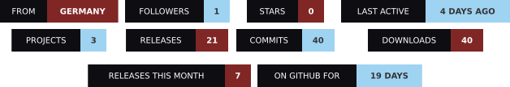</a>
<!-- stats:end -->

  

<!-- games:start -->
<table>
<tr>
<td width="33%" valign="top">
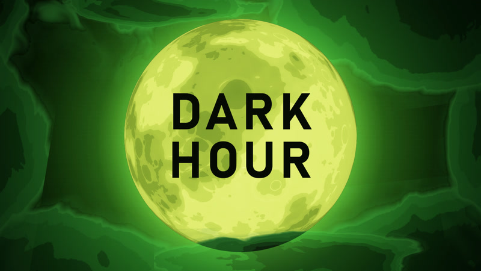
<h3>DarkHour</h3>
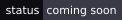

</td>
<td width="33%" valign="top">
<a href="https://github.com/ILIuIcIaI/enterhaken-prototyp">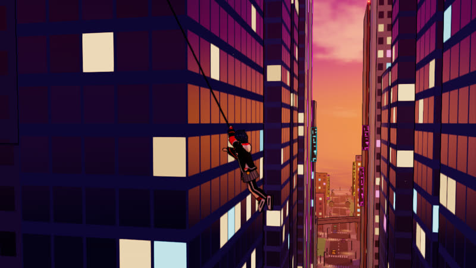</a>
<h3><a href="https://github.com/ILIuIcIaI/enterhaken-prototyp">Grappling Hook Prototype</a></h3>
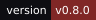

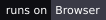
</td>
<td width="33%" valign="top">
<a href="https://github.com/ILIuIcIaI/Call-of-Duty-Black-Warfare-69">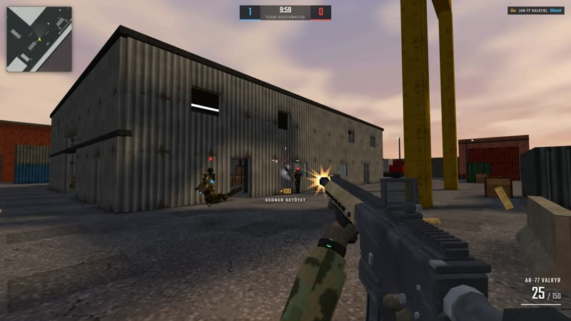</a>
<h3><a href="https://github.com/ILIuIcIaI/Call-of-Duty-Black-Warfare-69">Call of Duty Black Warfare 69</a></h3>
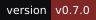
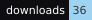

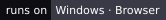
</td>
</tr>
</table>
<!-- games:end -->

 

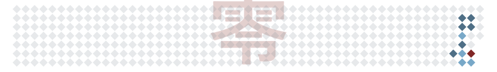

 

